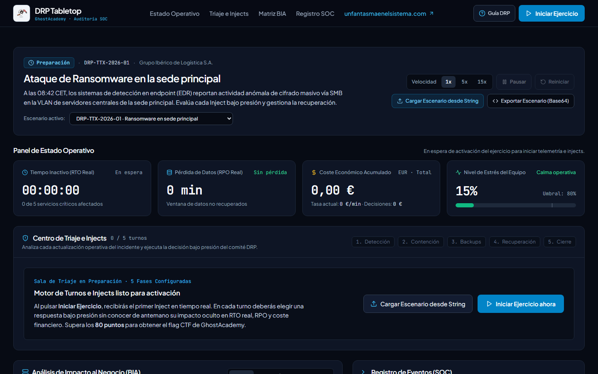
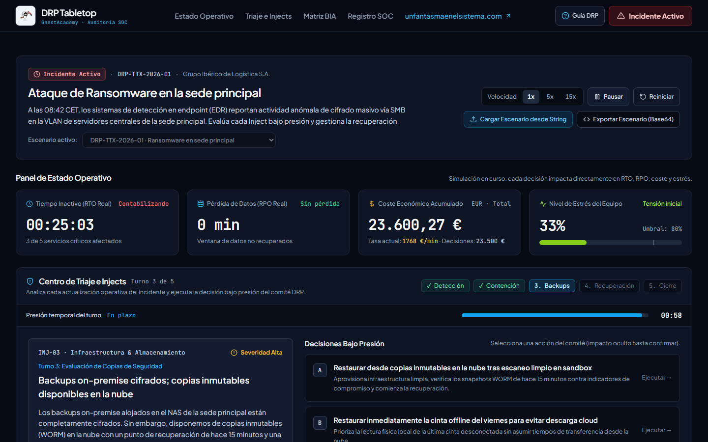
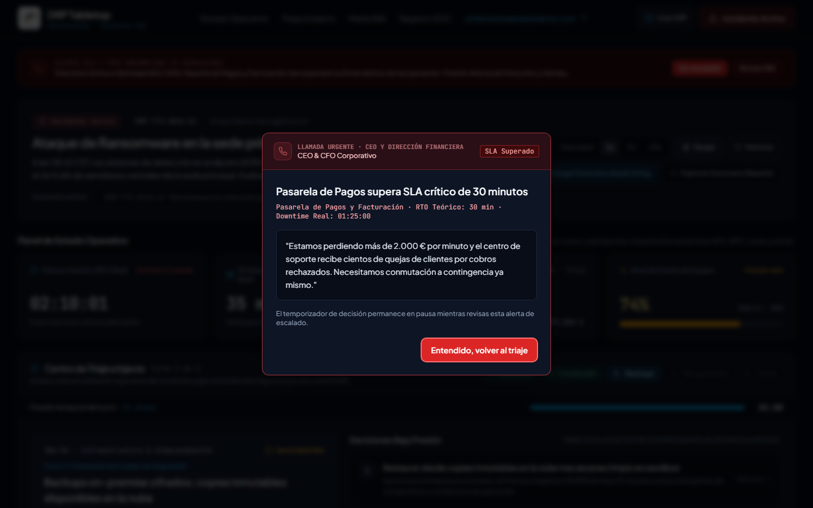
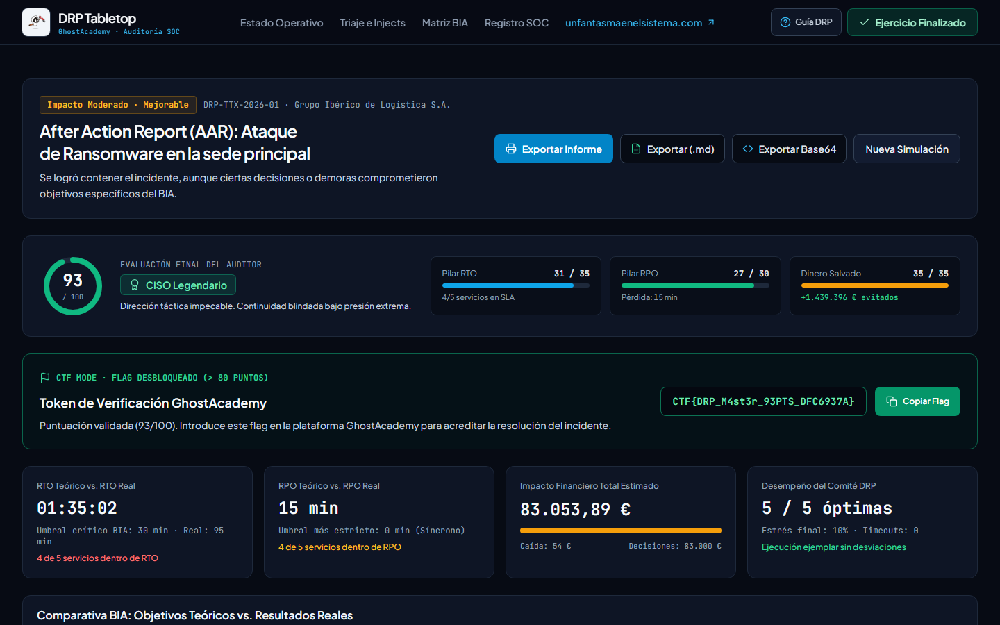
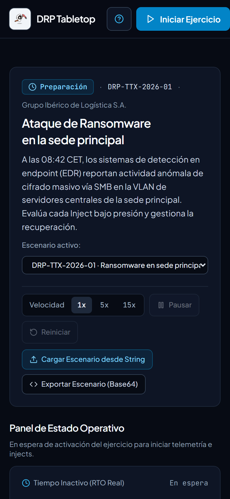

<div align="center">
  <a href="https://www.unfantasmaenelsistema.com/" target="_blank" rel="noopener noreferrer">
    
  </a>

  # DRP Tabletop — Centro de Mando y Simulación SOC

  **Simulador educativo 100% frontend de Planes de Recuperación ante Desastres (Disaster Recovery Plan) estilo Centro de Operaciones de Seguridad (SOC)**

  [](https://unfantasmaenelsistema.github.io/DRP-Tabletop/)
  [](#arquitectura-y-stack-técnico)
  [-64748b?style=flat-square)](#)
  [](./LICENSE)

  **[▶ Abrir el simulador](https://unfantasmaenelsistema.github.io/DRP-Tabletop/)** · Desarrollado para **[GhostAcademy — Un Fantasma en el Sistema](https://www.unfantasmaenelsistema.com/)**
</div>

---

## Tabla de Contenidos

- [Descripción General](#descripción-general)
- [Capturas Reales de la Aplicación](#capturas-reales-de-la-aplicación)
- [Funcionalidades Principales](#funcionalidades-principales)
- [Atajos de Teclado](#atajos-de-teclado)
- [Arquitectura y Stack Técnico](#arquitectura-y-stack-técnico)
- [Despliegue en GitHub Pages y Desarrollo Local](#despliegue-en-github-pages-y-desarrollo-local)
- [Novedades de la versión 2](#novedades-de-la-versión-2)
- [Autoría y Licencia](#autoría-y-licencia)

---

## Descripción General

**DRP Tabletop** es un simulador interactivo de ejercicios de mesa (*Tabletop Exercises*) diseñado para entrenar a equipos de seguridad, sistemas y continuidad de negocio en la toma de decisiones críticas bajo presión temporal.

La aplicación funciona **íntegramente en el navegador** (sin backend ni llamadas externas a APIs de datos), combinando telemetría de impacto económico en tiempo real, un motor de turnos con *Injects* y consecuencias ocultas, indicadores dinámicos de **BIA (Business Impact Analysis)**, visualización analítica con **D3.js** y un informe ejecutivo **After Action Report (AAR)** exportable a PDF y Markdown.

---

## Capturas Reales de la Aplicación

> Capturas de la versión 2 tomadas sobre la compilación de producción, jugando partidas reales del escenario de ransomware.

### 1. Dashboard de Mando (Estado de Preparación)
Selector de escenarios integrados, KPIs operativos en tiempo real, barra de estrés y matriz BIA inicial.



### 2. Motor de Turnos, Injects y Registro SOC con D3.js
Gestión de *Injects* bajo cuenta regresiva de 60 segundos, decisiones con impacto oculto, barra de estrés con transición cromática progresiva y gráfico de barras agrupadas en D3.js por severidad y turno.



### 3. Escalado Ejecutivo por Incumplimiento de SLA / RTO
Cuando un servicio crítico supera su RTO teórico, el simulador pausa el reloj de decisión, activa el banner rojo de alerta y lanza el modal de llamada urgente de Dirección o clientes.



### 4. After Action Report (AAR), Rango Corporativo y CTF Mode
Evaluación de 0 a 100 puntos, medidor circular SVG, comparativa visual Teórico vs. Real de RTO/RPO por servicio, desglose de aciertos/errores, Lecciones Aprendidas automatizadas y generación del token `CTF{DRP_M4st3r_...}`.



### 5. Versión móvil



---

## Funcionalidades Principales

- **3 Escenarios Corporativos Integrados**:
  1. `DRP-TTX-2026-01` — **Ataque de Ransomware en la sede principal** (*Grupo Ibérico de Logística S.A.*): movimiento lateral SMB/445, compromiso de Directorio Activo, Pasarela de Pagos y evaluación de copias inmutables WORM.
  2. `DRP-TTX-2026-02` — **Caída de Región Cloud y Corrupción de Base de Datos** (*Fintech Ibérica Pay S.L.*): failover multi-región, protección de réplicas PostgreSQL, *Point-in-Time Recovery (PITR)*, idempotencia en Kafka y notificación regulatoria DORA.
  3. `DRP-TTX-2026-03` — **Compromiso Supply Chain en Pipeline CI/CD** (*NubeSalud Digital S.A.*): rollback de artefactos firmados (Cosign/SLSA), rotación de secretos en Vault, verificación de integridad WORM clínica y notificación RGPD Art. 33.
- **Panel de Estado Operativo (4 KPIs en tiempo real)**:
  - **Tiempo Inactivo (RTO Real)** y recuento de servicios críticos afectados.
  - **Pérdida de Datos (RPO Real)** acumulada por decisiones.
  - **Coste Económico Acumulado** (lucro cesante por minuto de caída + coste directo de decisiones).
  - **Nivel de Estrés del Equipo** con transición cromática dinámica (`emerald` → `lime` → `amber` → `orange` → `red`) y marcador de umbral crítico al `80%`.
- **Motor de Presión Temporal (60 s por turno)**:
  - Temporizador visual por turno con velocidades simuladas (`1x`, `5x`, `15x`) y pausa/reanudación.
  - Si el tiempo se agota, el simulador aplica automáticamente la opción más adversa con penalización añadida de RTO, RPO, coste y estrés.
- **Matriz BIA Interactiva**:
  - Comparativa continua de RTO/RPO teórico frente a real con cambio de estado visual (`verde` → `ámbar` → `rojo` pulsante).
  - Filtros (`Todos`, `Nivel Crítico`, `Afectados`) e inspector técnico inferior con responsable, dependencias y estrategia de recuperación.
- **Consola de Eventos SOC + Gráfico D3.js v7**:
  - Gráfico de barras agrupadas interactivo (*Crítico*, *Alerta*, *Info* a través de `Prep` y `T1..T5`) con *tooltip* y clic para filtrar la consola.
  - Exportación del registro completo a archivo `.txt`.
- **After Action Report (AAR) Completo**:
  - **Puntuación 0–100** ponderada en 3 pilares: **RTO (35 pts)**, **RPO (30 pts)** y **Dinero Salvado (35 pts)**.
  - **Rangos corporativos**: `CISO Legendario` (`≥ 90`), `Arquitecto de Resiliencia` (`81–89`), `Analista SOC Senior` (`65–80`), `Administrador Novato` (`45–64`) y `Despedido` (`< 45`).
  - **CTF Mode (GhostAcademy)**: Al superar **80/100 puntos** en uno de los **escenarios oficiales sin modificar**, genera el token `CTF{DRP_M4st3r_<PUNTOS>PTS_<HASH>}`, cuyo hash resume el escenario, la puntuación, las decisiones óptimas, el RTO, el RPO y el coste de la partida. Con un escenario importado o editado el informe lo indica y no da bandera. Es un comprobante educativo calculado en el navegador, no una firma criptográfica: sirve para la clase, no como prueba frente a alguien que manipule el código o el `localStorage`.
  - Exportación optimizada a **PDF** (`window.print()` con `@media print` en blanco limpio), **Markdown (`.md`)** y **Escenario Base64**.
- **Persistencia y Modo Docente (Base64 + JSON)**:
  - Guardado automático de sesión en `localStorage`.
  - Botones **Cargar Escenario desde String** y **Exportar Escenario (Base64)** / **Descargar JSON editable** para que instructores diseñen y compartan escenarios personalizados. Los textos de un escenario importado se muestran escapados: un escenario manipulado no ejecuta código en el navegador de quien lo carga.
- **Guía Táctica DRP y Atajos de Teclado**:
  - Modal de referencia rápida accesible desde la barra superior o pulsando `?`.

---

## Atajos de Teclado

| Tecla | Acción |
| :---: | :--- |
| `A`–`D` o `1`–`4` | Ejecutar opción del turno activo (*Decisiones Bajo Presión*) |
| `P` | Pausar o reanudar la simulación |
| `?` | Abrir o cerrar la Guía Táctica DRP y glosario |
| `Esc` | Cerrar el modal activo (Guía, Base64 o Alerta SLA) |

---

## Arquitectura y Stack Técnico

- **HTML5 semántico** (`index.html`) con accesibilidad ARIA y diseño responsive.
- **Tailwind CSS 3 compilado** con Vite en el build (antes se cargaba desde el CDN de desarrollo, que avisa de no usarse en producción) más `styles.css` con el `@media print` para los informes PDF y el soporte de `prefers-reduced-motion`. El aspecto es el mismo: comparado píxel a píxel en cinco vistas, en escritorio y en móvil.
- **Vanilla JavaScript ES Module** (`app.js`) sin frameworks ni servidor.
- **D3.js 7.9.0** (CDN con versión fija) para el gráfico de frecuencia de alertas en el Registro SOC.
- **Estructura del repositorio**:
  - `index.html`, `app.js` y `styles.css` — Aplicación.
  - `src/styles.css`, `tailwind.config.js`, `postcss.config.js` y `vite.config.js` — Compilación (base relativa `./`, válida para la subruta de GitHub Pages).
  - `public/assets/logo.png` — Emblema de la casa.
  - `.github/workflows/deploy.yml` — Compilación con Bun y despliegue en GitHub Pages.
  - `docs/screenshots/` — Capturas reales.

---

## Despliegue en GitHub Pages y Desarrollo Local

El flujo [`.github/workflows/deploy.yml`](./.github/workflows/deploy.yml) se ejecuta en cada `push` a `main`: instala con Bun (`bun install --frozen-lockfile`), compila `./dist` y lo publica en https://unfantasmaenelsistema.github.io/DRP-Tabletop/ (en **Settings → Pages**, la fuente es **GitHub Actions**).

### Ejecución local

Requisitos: **[Bun](https://bun.sh/)** (el proyecto usa `bun.lock`).

```bash
git clone https://github.com/unfantasmaenelsistema/DRP-Tabletop.git
cd DRP-Tabletop
bun install
bun run dev        # http://localhost:3000
bun run build      # genera ./dist para publicar
```

Abrir `index.html` directamente ya no basta: los estilos de Tailwind se generan al compilar.

---

## Novedades de la versión 2

- **Publicado en GitHub Pages.** El workflow fallaba (`npm ci` sin `package-lock.json` y Pages sin activar). Ahora compila con Bun y publica.
- **La bandera CTF ya no se puede fabricar.** Bastaba importar un escenario con el mismo código que el oficial y decisiones sin impacto para sacar una bandera de 100 puntos idéntica a las legítimas. Ahora solo los escenarios oficiales sin modificar dan bandera, también tras recargar a mitad de partida.
- **Tailwind compilado** y **D3 con versión fija** (`d3@7` podía cambiar sin aviso).
- **Limpieza**: fuera el esqueleto de React, Gemini, Express y demás restos de AI Studio que no se usaban; el logo pasa a `public/assets/logo.png`.

---

## Autoría y Licencia

- Proyecto educativo creado para **[Un Fantasma en el Sistema — GhostAcademy](https://www.unfantasmaenelsistema.com/)**.
- Distribuido bajo licencia [MIT](./LICENSE).
